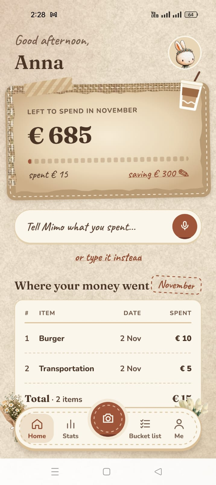
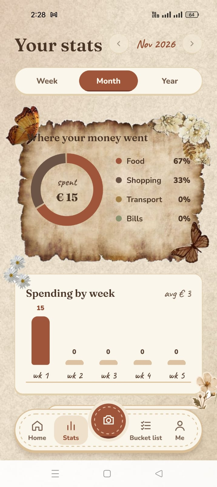
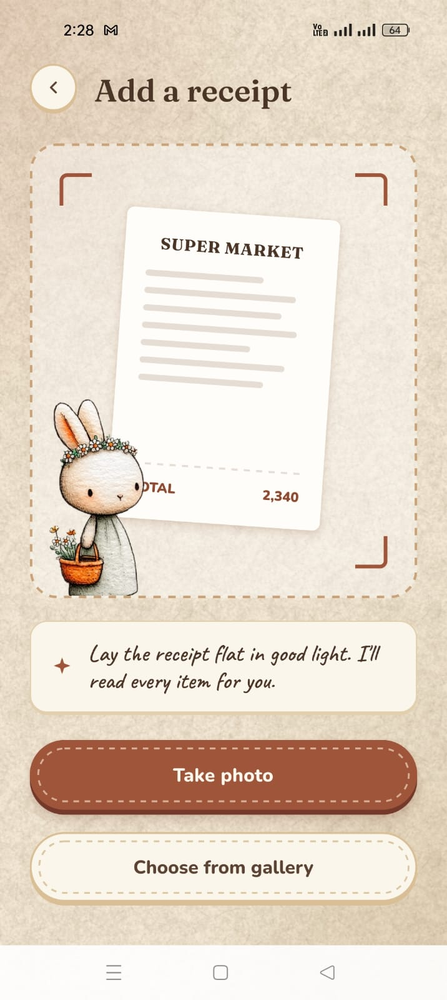
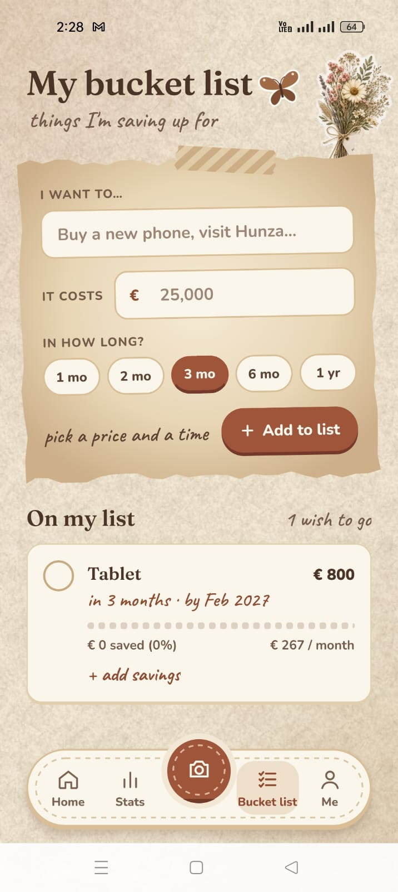
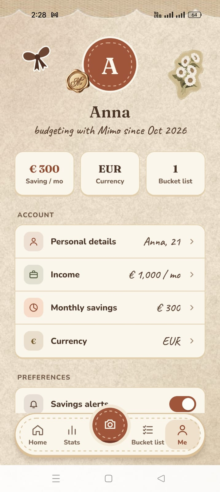
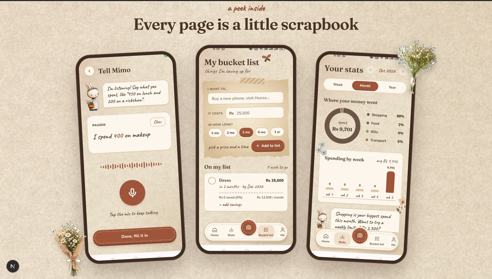
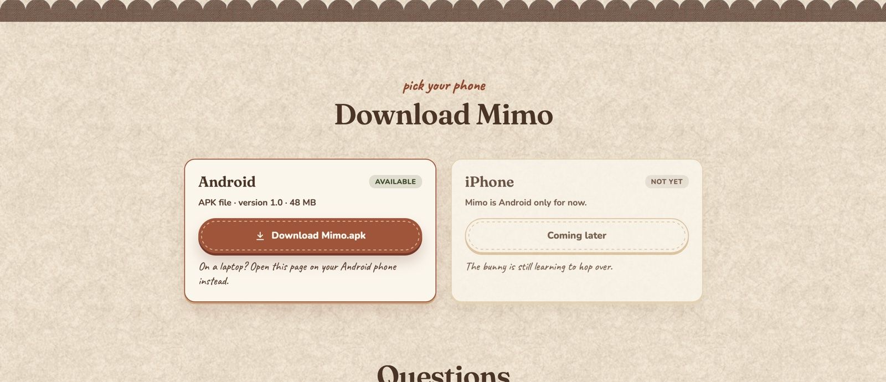
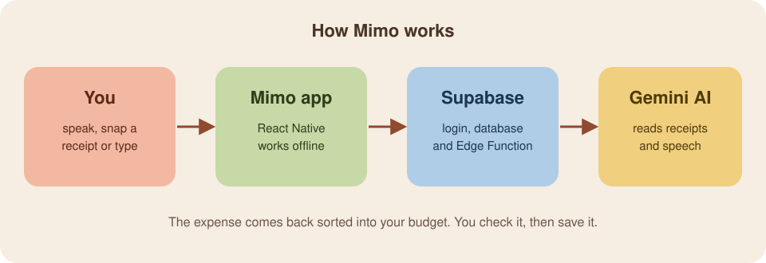

# Mimo

<table>
  <tr>
    <td width="66%" valign="middle">
      <h3>A cosy, voice-first budget journal for Android.</h3>
      <p><i>"I'll help you keep track of your money, one tiny carrot at a time."</i></p>
      <p>
        Say what you spent, snap a receipt or type it in. Mimo sorts it into your budget, keeps
        your savings goal safe and warns you before you overspend.
      </p>
    </td>
    <td width="34%" align="center" valign="middle">
      
    </td>
  </tr>
</table>

<p align="center">
  <a href="https://mimo-virid.vercel.app">
    
  </a>
</p>

## What is Mimo?

Mimo is a budget app for Android with a little bunny who listens. You tell it what you spent,
by voice, by photo of a receipt or by typing, and it adds the expense to your monthly budget for you.
You pick how much you want to save each month, and Mimo warns you before your spending eats into it.

### The problem it solves

Most people stop tracking their spending after a week or two. Budget apps feel like
spreadsheets: every coffee means opening the app, choosing a category, typing an amount and a
date. It's tedious, so people give up, and at the end of the month they don't know where the
money went or why there's nothing left to save.

### Why Mimo is different

- **Talk, don't type.** Say *"450 on lunch and 200 on a rickshaw"* and Mimo logs both items in one go,
  in English, Urdu or Roman Urdu.
- **Savings come first.** Mimo takes your savings goal out of your income before anything else, so
  the number on the Home screen is what you can *actually* spend.
- **Warnings before it's too late.** You're told at 80% of your spending money, not after the month is over.
- **Made for local life.** Roman Urdu, rickshaws and PKR are first class, and 34 currencies are supported.
- **Cosy, not clinical.** Every screen looks like a page from a hand-made scrapbook, so opening the app
  feels nice rather than like homework.
- **You stay in control.** Every AI reading is shown to you first. Nothing is saved until you confirm it.

## Demo

<p align="center">
  <a href="mimo_image_video/Full_video.mp4">
    
  </a>
  <br />
  Onboarding, adding an expense, savings, voice, stats, the bucket list and settings, at 3× speed.<br />
  <a href="mimo_image_video/Full_video.mp4"><b>▶ Watch the full video (1:54)</b></a>
</p>

## Modules

| | Module | What it does |
|---|---|---|
| 🎙️ | **Voice** | Speak naturally and Mimo splits the sentence into separate expenses, each with an amount and category. |
| 🧾 | **Receipt scanner** | Take a photo or pick one from the gallery. Mimo reads the shop, every line item and the total. |
| ⌨️ | **Manual entry** | A quick form with amount, note, category and date for when you can't talk. |
| 💰 | **Budget** | *Income − savings goal = what you can spend.* The Home card shows what's left this month. |
| 🔔 | **Alerts** | A warning at **80%** of your spending money, and another when spending starts eating into savings. |
| 📊 | **Stats** | Week, month and year views with a category donut, spending by week, and every item listed to edit or delete. |
| 🎯 | **Bucket list** | Savings goals with a price and a deadline. Mimo works out how much to put aside each month. |
| 👤 | **Me** | Profile, income, savings goal and currency (34 to choose from), plus sign-out and account deletion. |
| 📴 | **Offline sync** | Every change is saved on the phone first and synced when you're back online. |
| 🔐 | **Accounts** | Email and password or Google Sign-In, with password reset. |

## Screenshots

<p align="center">
  
  
  
</p>
<p align="center">
  
  
  
</p>
<p align="center">
  <i>Welcome · Home · Stats · Scan a receipt · Bucket list · Me</i>
</p>

## Website

Mimo isn't on the Play Store. It's downloaded as an APK from its own landing page,
[mimo-virid.vercel.app](https://mimo-virid.vercel.app), built with Next.js in a separate repo,
[Mimo_Landing](https://github.com/nabighasafdar/Mimo_Landing).

<p align="center">
  
  
</p>

## How it works

<p align="center">
  
</p>

1. **You** say what you spent, snap a receipt or type it in.
2. **The Mimo app** saves everything on the phone first, so it works without internet.
3. **Supabase** handles login and stores your data. Each user can only see their own rows.
4. **Gemini AI** reads the receipt photo or spoken text and returns the items and amounts.
   Only text is sent, never a voice recording. If the AI can't be reached, the phone makes its own guess.

## Tech stack

| Part | Tool |
|---|---|
| App | React Native 0.87, React 19, TypeScript |
| Navigation | React Navigation native stack, with a custom bottom tab bar |
| Graphics | `react-native-svg`, hand-drawn sticker art |
| Backend | Supabase: Postgres, Auth, Edge Functions (Deno) |
| AI | Google Gemini, called only from the Edge Function (30 reads per user per day) |
| Speech | Android `SpeechRecognizer`, wrapped in a Kotlin native module |
| Sign-in | `@react-native-google-signin/google-signin` |
| Tests | Jest |
| Website | Next.js on Vercel ([Mimo_Landing](https://github.com/nabighasafdar/Mimo_Landing)) |

Mimo is Android-only for now. iOS isn't set up, and voice input uses an Android-only module.

## Data model

| Table | What it holds |
|---|---|
| `profiles` | Name, age, income type and amount, currency and monthly savings goal, one row per user |
| `expenses` | Amount, category (Food, Transport, Shopping, Bills), note, date and the spoken words for voice entries |
| `goals` | Bucket-list items: title, target, amount saved and deadline |
| `ai_usage` | How many AI reads each user made per day. Only the server can touch it. |

A new profile is created automatically on sign-up. Deleting an account removes every row that
belongs to it.

## Run it locally

You need **Node 22.11+**, **Android Studio** and an Android phone with USB debugging on, or an emulator.

```bash
npm install
npm start          # Metro bundler, keep it running
npm run android    # in a second terminal: builds and installs on the phone
npm test           # run the Jest tests
```

## Backend setup

1. Create a Supabase project and run [`supabase/schema.sql`](supabase/schema.sql) in **SQL Editor**. It's safe to run again.
2. Put your Gemini key in `supabase/functions/.env` as `GEMINI_API_KEY=...`. This file is git-ignored.
3. Set the secret and deploy the function:

   ```bash
   npx supabase secrets set --env-file supabase/functions/.env --project-ref <project-ref>
   npx supabase functions deploy read-receipt --no-verify-jwt --project-ref <project-ref>
   ```

4. In **Authentication → URL Configuration**, add your website's `/reset-password` page to the redirect URLs.
5. Put your Supabase URL, publishable key, website URL and Google web client ID in [`src/config.ts`](src/config.ts).

The publishable key is safe to ship in the app, because row level security protects the data.

## Release build

Signing needs `android/keystore.properties` and `android/app/mimo-release.keystore`. Both are
git-ignored. Back them up somewhere safe, because an installed app can only be updated with the same key.

```bash
cd android && ./gradlew assembleRelease
adb install -r app/build/outputs/apk/release/app-release.apk
```

## Privacy

Mimo has no ads and no analytics, doesn't sell data and doesn't connect to your bank. Receipt photos
and voice recordings aren't stored. Read the full [privacy policy](https://mimo-virid.vercel.app/privacy),
or [delete your account](https://mimo-virid.vercel.app/delete-account) at any time.

---

<div align="center">
Made with 🥕 by <a href="https://github.com/nabighasafdar">Nabigha Safdar</a>
</div>
