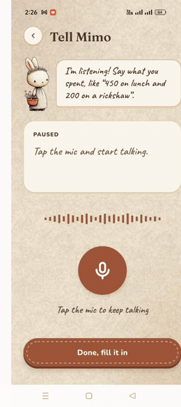
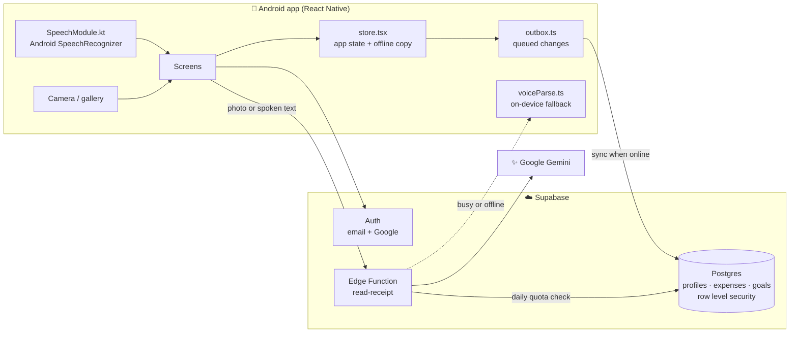

<div align="center">


# Mimo

**A cosy, voice-first budget journal for Android.**
*"I'll help you keep track of your money, one tiny carrot at a time."*

Say what you spent, snap a receipt or type it in. Mimo sorts it into your budget, keeps your
savings goal safe and warns you before you overspend.

[**Download the APK**](https://mimo-virid.vercel.app) ·
[Watch the demo](mimo_image_video/Full_video.mp4) ·
[Privacy policy](https://mimo-virid.vercel.app/privacy)


</div>

---

## Screenshots

<table>
  <tr>
    <td align="center"><br /><b>Welcome</b></td>
    <td align="center"><br /><b>Home</b></td>
    <td align="center"><br /><b>Stats</b></td>
  </tr>
  <tr>
    <td align="center"><br /><b>Scan a receipt</b></td>
    <td align="center"><br /><b>Bucket list</b></td>
    <td align="center"><br /><b>Me</b></td>
  </tr>
</table>

## Demo

<table>
  <tr>
    <td width="280">
      <a href="mimo_image_video/Full_video.mp4"></a>
    </td>
    <td>
      <b>Logging an expense by voice</b>
      <ol>
        <li>Tap the mic on Home and say <i>"I spent $5 on transportation"</i>.</li>
        <li>Mimo shows the words live while you speak.</li>
        <li>The AI turns the sentence into an expense with a name, amount and category.</li>
        <li>You check it, tap <b>Add</b>, and the Home card and Stats update immediately.</li>
      </ol>
      <a href="mimo_image_video/Full_video.mp4"><b>▶ Watch the full walkthrough (1:54)</b></a>.
      It covers sign-up, onboarding, adding expenses, savings, voice, stats, the bucket list and settings.
    </td>
  </tr>
</table>

## What Mimo does

| | Feature | Details |
|---|---|---|
| 🎙️ | **Tell Mimo what you spent** | Speak naturally, e.g. *"450 on lunch and 200 on a rickshaw"*. Several items in one sentence, in English, Urdu or Roman Urdu. |
| 🧾 | **Scan a receipt** | Take a photo or pick one from the gallery. Mimo reads the shop, every line item and the total. |
| ⌨️ | **Type it instead** | A quick form with amount, note, category and date for when you can't talk. |
| 💰 | **Monthly budget** | *Income − savings goal = what you can spend.* The Home card shows what's left this month. |
| 🔔 | **Savings alerts** | A warning at **80%** of your spending money, and another when spending starts eating into savings. |
| 📊 | **Stats** | Week, month and year views with a category donut, a spending-by-day/week chart, and every item listed so you can edit or delete it. |
| 🎯 | **Bucket list** | Savings goals with a price and a deadline. Mimo works out how much to put aside each month. |
| 🌍 | **34 currencies** | PKR, EUR, USD, GBP, AED and more. Change it any time from **Me**. |
| 📴 | **Works offline** | Every change is saved on the phone first and synced when you're back online. |
| 🔐 | **Accounts** | Email and password or Google Sign-In, password reset, and full account deletion from the app. |

Every AI reading is shown to you first. Nothing is saved until you confirm it.

## How it works



- **Voice:** Android's built-in speech recognition turns your voice into text on the phone. Only the text is sent to the AI, never a recording.
- **AI reading:** the `read-receipt` Edge Function sends the photo or text to Gemini and asks for a fixed JSON shape, so the app can trust the result. If one Gemini model is busy it tries the next one. Each user gets **30 AI reads a day**, so the API bill stays under control.
- **Fallback:** if the AI can't be reached, spoken entries are read on the phone with a keyword parser, and Mimo tells you it guessed.
- **Offline first:** changes go into an outbox on the phone and are sent to Supabase in order once there is a connection.
- **Security:** row level security means each signed-in user can only read and change their own rows. The Gemini key lives only on the server.

## Tech stack

| Part | Tool |
|---|---|
| App | React Native 0.87, React 19, TypeScript |
| Navigation | React Navigation native stack, with a custom bottom tab bar |
| Graphics | `react-native-svg`, hand-drawn sticker art |
| Backend | Supabase: Postgres, Auth, Edge Functions (Deno) |
| AI | Google Gemini, called only from the Edge Function |
| Speech | Android `SpeechRecognizer`, wrapped in a Kotlin native module |
| Sign-in | `@react-native-google-signin/google-signin` |
| Tests | Jest |
| Website | Landing page on Vercel ([Mimo_Landing](https://github.com/nabighasafdar/Mimo_Landing)); privacy, password reset and account deletion pages in `docs/` |

Mimo is Android-only for now. iOS isn't set up, and voice input uses an Android-only module.

## Project layout

```text
App.tsx                     App entry: safe-area provider and navigation
src/
  navigation.tsx            Every screen and how they connect
  screens/                  One file per screen (Home, Stats, Goals, Me, Voice, Scan, onboarding…)
  components/               Shared UI: cards, stickers, torn paper, tab bar
  store.tsx                 App state, loading, offline copy, currencies
  outbox.ts                 Queue that syncs changes to the database
  db.ts                     Reads and writes to Supabase
  budget.ts                 Budget, alert levels and date maths
  receipt.ts                Calls the AI for photos and spoken text
  voiceParse.ts             On-device parser used when the AI is unavailable
  speech.ts                 React hook around the native speech module
  googleAuth.ts, auth.ts    Sign-in, sign-up and password reset
  config.ts                 Public settings (Supabase URL, website URL…)
android/…/SpeechModule.kt   Native Android speech recognition
supabase/
  schema.sql                Tables, row level security, triggers, account deletion, AI quota
  functions/read-receipt/   Edge Function that talks to Gemini
docs/                       Privacy policy, password reset and delete-account pages
__tests__/                  Jest tests for budget maths, outbox, store and voice parser
mimo_image_video/           Screenshots and demo video used in this README
```

## Data model

| Table | What it holds |
|---|---|
| `profiles` | Name, age, income type and amount, currency and monthly savings goal, one row per user |
| `expenses` | Amount, category (Food, Transport, Shopping, Bills), note, date and the spoken words for voice entries |
| `goals` | Bucket-list items: title, target, amount saved and deadline |
| `ai_usage` | How many AI reads each user made per day. Only the server can touch it. |

A new profile is created automatically on sign-up. Deleting an account removes every row that
belongs to it.

## Run it locally

You need **Node 22.11+**, **Android Studio** and an Android phone with USB debugging on, or an emulator.

```bash
npm install
npm start          # Metro bundler, keep it running
npm run android    # in a second terminal: builds and installs on the phone
npm test           # run the Jest tests
```

## Backend setup

1. Create a Supabase project and run [`supabase/schema.sql`](supabase/schema.sql) in **SQL Editor**. It's safe to run again.
2. Put your Gemini key in `supabase/functions/.env` as `GEMINI_API_KEY=...`. This file is git-ignored.
3. Set the secret and deploy the function:

   ```bash
   npx supabase secrets set --env-file supabase/functions/.env --project-ref <project-ref>
   npx supabase functions deploy read-receipt --no-verify-jwt --project-ref <project-ref>
   ```

4. In **Authentication → URL Configuration**, add your website's `/reset-password` page to the redirect URLs.
5. Put your Supabase URL, publishable key, website URL and Google web client ID in [`src/config.ts`](src/config.ts).

The publishable key is safe to ship in the app, because row level security protects the data.

## Release build

Signing needs `android/keystore.properties` and `android/app/mimo-release.keystore`. Both are
git-ignored. Back them up somewhere safe, because an installed app can only be updated with the same key.

```bash
cd android && ./gradlew assembleRelease
adb install -r app/build/outputs/apk/release/app-release.apk
```

## Privacy

Mimo has no ads and no analytics, doesn't sell data and doesn't connect to your bank. Receipt photos
and voice recordings aren't stored. Read the full [privacy policy](https://mimo-virid.vercel.app/privacy),
or [delete your account](https://mimo-virid.vercel.app/delete-account) at any time.

---

<div align="center">
Made with 🥕 by <a href="https://github.com/nabighasafdar">Nabigha Safdar</a>
</div>
